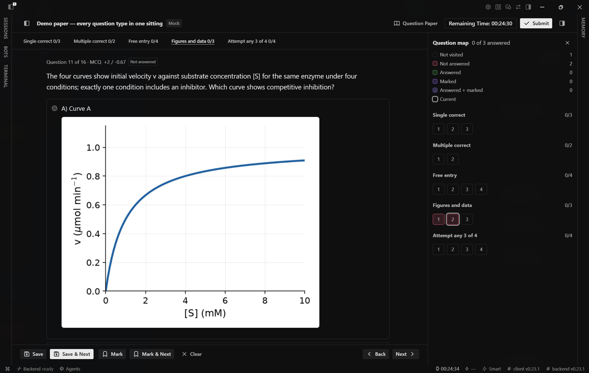
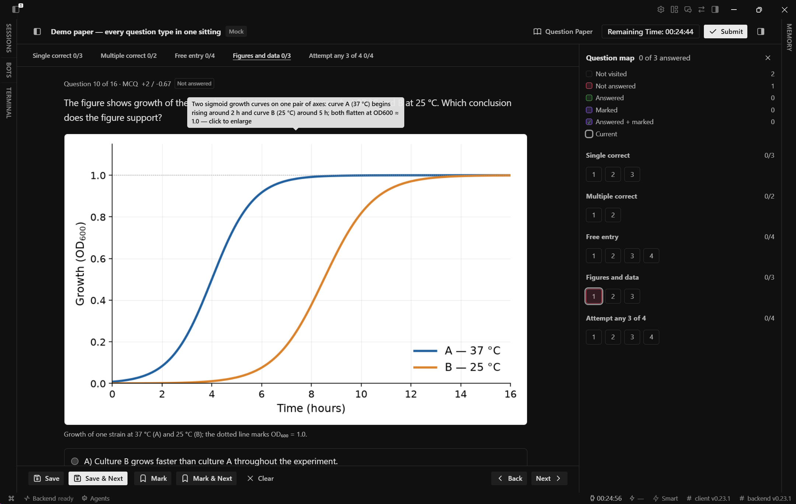

# Exam Desk

Practice exams inside Hermes Desktop. Add a paper, sit it on a timer, and get a
scored result with an AI review of what you missed.

Any exam works. A paper is a JSON file, so a new exam is a new file, not new code.

Needs Hermes 0.23.0 or newer. Version 0.13.3.

## What it looks like

A mock sitting, with the question's figure and the palette beside it:



Figures can sit on the options themselves, so a curve-identification question
reads like the paper it came from:



## Words

- **Exam**: the group you prepare for, such as `gat-b`.
- **Paper**: one question file. This is what you sit.
- **Attempt**: one sitting of one paper, in Assisted or Mock mode.

## Install

```bash
hermes plugins install https://github.com/darshak26/hermes-exam-desk
hermes plugins enable exam-desk
hermes gateway restart
```

Exam Desk then appears in the sidebar. The restart loads the agent half (skills
and the AI bridge). Without it the panel still works, but AI review stays off
until the next gateway start.

The desktop panel is a separate switch, off by default:

- On the machine running Hermes Desktop, open Capabilities, then Plugins, find
  Exam Desk under Desktop, and enable it.
- If the app runs on a laptop and Hermes on a server, install it from the app
  with Desktop as the target, then enable it there. Enabling it on the server
  does nothing.

After an update, restart the dashboard too. Its routes load once at boot. Until
the restart, the panel shows "Not Found" for any route that is new.

## First run

A 16 question demo paper is added on first start. It covers every question type
and marking. Use it to try the timer, palette and result page, then delete it.

## Add a paper

- **Add exam** (page header) starts a new exam. The agent asks which exam and
  which year, one question at a time.
- **Add paper** (on an exam card) adds another year to an exam you already have.

The agent looks for an official paper first. It drafts one only when no official
paper exists for that exam and year, or when you ask for practice on a topic.
Drafted papers are marked AI-drafted. The agent says which route it took before
it starts.

Sourcing needs web tools on the agent. Without them, write the paper by hand
using `skills/pyq/references/pack-schema.md`, then install it.

## Modes

- **Assisted**: the paper sits in a pane beside the chat, so the tutor is one
  message away while the timer runs.
- **Mock**: full page, no chat, no help.

Both are scored. Their analysis never mixes, so an assisted sitting never counts
as mock progress.

## Result page

Shows one attempt at a time, with arrows and a bar chart of marks per attempt.

- **Discuss in chat** sends the attempt to the agent.
- **Drill misses** builds a new paper from this attempt's wrong answers.

## Agent

The agent half bundles four skills, `pyq`, `draft`, `assist` and `review`, and
adds five tools: `exam_desk_papers`, `exam_desk_topics`, `exam_desk_live`,
`exam_desk_attempt` and `exam_desk_doubt`. `/examdesk` prints a short status in
any chat.

## Papers on disk

Papers live in `~/.hermes/plugin-data/exam-desk/packs/<paper_id>.json`, or in
`$EXAM_DESK_DATA_DIR` if set. The format and grading rules are in
`skills/pyq/references/pack-schema.md`.

```bash
python3 skills/pyq/scripts/validate_pack.py my-paper.json
python3 skills/pyq/scripts/install_pack.py my-paper.json
```

- A second paper needs a slug with its year (`gat-b-2022` beside `gat-b-2023`)
  and `exam: "gat-b"` in the file.
- Replacing a paper needs `--replace`. The old file is kept under
  `packs/superseded/`.
- Figures go in `packs/<paper_id>.assets/`, beside the JSON.

## API

The dashboard endpoints are in `docs/api.md`.

## Settings

Keep `plugins.isolation: in_process`. With `host` isolation the AI review cannot
reach the model, and evaluation returns `503`.

## Privacy

The plugin makes no network calls of its own. Sourcing uses the agent's web
tools, and review uses the agent's configured model. It stores no credentials.

## Develop

```bash
python -m pytest -q          # run with the gateway's Python venv
hermes plugins validate .    # the check CI runs
```

`docs/development.md` covers the ship chain, the CSS audit and the verification
bar. `docs/` also holds the design records.
